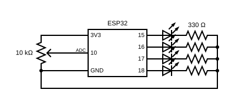

# Atividade 03 - ADC

## Função
Acende e apaga uma ordem de led's na medida que é alterado o valor do potenciômetro. 

## Descrição e diagrama esquemático
- LED com resistor de 330Ω indo para o GND nos pinos 15, 16, 17 e 18.
- Potenciômetro ligado a um pino 3V3, a um pino GND e o cursor ligado ao pino 10
- `analogRead(10)` - envia um valor entre 0 e 4095 para o pino 10.

## O que aprendi atividade 03
- **ADC:** O uso de diferentes entradas, variadas pelo potenciômetro, possibilitando diferentes saídas.

- **HIGH/LOW:** No primeiro teste fiz usando um if para cada range. E assim que executei, acendeu cada led e não desligaram fazendo o caminho contrário do potenciômetro. Daí lembrei que é imperativo, vai executar aquilo que eu indicar. Se eu indiquei o HIGH, vai executar só o HIGH. Então inclui um if, que poderiam ser else, para fazer o caminho contrário do potenciômetro para desligar os leds.

- **Máquina de estados finitos:** Importante ressaltar que esse HIGH/LOW não é máquina de estados finitos. Máquina de estados finitos remete a salvar estados anteriores e a partir do estado decidir o que é feito.

## Dificuldades
- Primeiro teste real não funcionou como esperado. Depois de algumas tentativas percebi que estava compilando e subindo o código da atividade anterior e não a atividade que eu estava trabalhando. Pesquisando sobre isso descobri que isso não é incomum. Preciso prestar mais atenção nisso enquanto estiver buildando.
