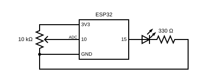

# Atividade 04 - PWM (Modulação por Largura de Pulso)

## Função

Simular intensidade em um sistema binário.

O esp32 funciona com 0v e 3.3v, 100% apagado ou 100% aceso. A forma de simular a intensidade é fazendo com que ele opere por intervalos de tempo.
Ele alterna entre o valor 0v e o valor 3.3v dentro de uma frequência fixa de 5000 vezes a cada segundo (5khz). A proporção de quanto tempo ele passa em 0v e em 3.3v é indicada pela variável intensidade em relação à resolução.

Para controlar esse tempo, foi definida uma resolução de 8 bits no PWM. Isso significa que cada ciclo foi dividido em 256 partes (de 0 a 255). O valor na variável `resolucao` escolhe quantas dessas partes serão em 3.3V:

Exemplo:
No Mínimo (Valor 0): O LED passa 0% do tempo ligado. Ele fica totalmente apagado.
Na Metade (Valor 127): O LED passa 50% do tempo ligado e 50% desligado dentro de cada ciclo. Isso simula ele recebendo 1.65v, fazendo com que ele pareça estar mais fraco (isso por piscar 5000 vezes por segundo).
No Máximo (Valor 255): O LED passa 100% do tempo ligado (255 partes de 255). Ele fica totalmente aceso (luz contínua).

Além disso, foi utilizado `analogRead()` recebendo a variação de tensão de um resistor variável para definir o valor de `intensidade`.

Como a leitura analógica do ESP32, `analogRead()`, tem uma resolução de 12 bits (valores de 0 a 4095) e o PWM foi definido `resolucao` com o valor de 8 bits (0 a 255), o código divide o valor lido por 16. Assim, cada grupo de 16 posições do potenciômetro representa exatamente 1 nível de intensidade do LED.

## Descrição e diagrama esquemático
- LED com resistor de 330Ω indo para o GND no pino 15.
- Potenciômetro ligado a um pino 3V3, a um pino GND e o cursor ligado ao pino 10
- `analogRead(10)` - envia um valor entre 0 e 4095 para o pino 10.

## O que aprendi atividade 04
- **PWM:** Intensidade usando valor binário.

- **Resolução:** Define a quantidade de divisões que o ciclo terá (no caso, 8 bits geram 256 níveis, de 0 a 255). Esse valor determina a precisão com que podemos ajustar o brilho do LED.

- **API tradicional != Versão Atual - Core 3.0+:** Na API antiga do ESP32, eram usadas três funções para configurar o PWM (`ledcSetup`, `ledcAttachPin` e `ledcWrite`). Na versão atual (Core 3.0+), a API foi simplificada: a configuração de pino, frequência e resolução foi unificada em uma única função chamada `ledcAttach()`, mantendo o `ledcWrite()` apenas para atualizar o valor da intensidade.

## Dificuldades
- Entender a divisão do tempo, como execução de um ciclo inteiro.
- Compreensão entre entrada e definição da intensidade.
