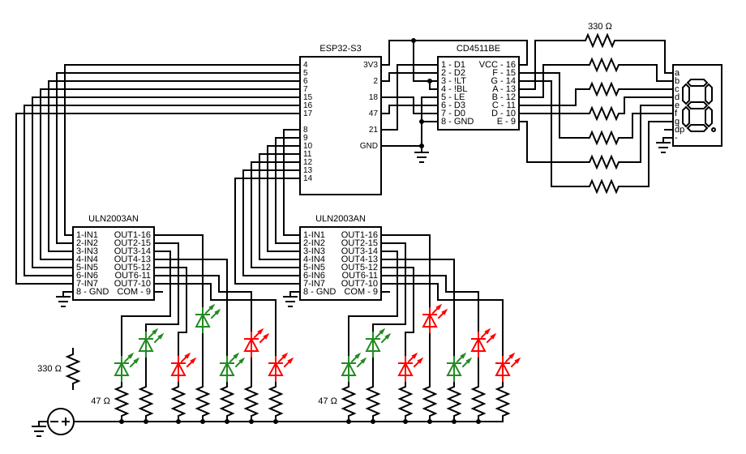

# Atividade 05 - Árvore Binária com Recursividade e Display

## Função

Percorrer uma árvore binária de decisões usando recursividade, acendendo LEDs para mostrar o caminho e exibindo o valor acumulado da soma em um display de 7 segmentos.

O objetivo é simular os caminhos de "Sim" ou "Não" (pegar ou não pegar um item), mostrando visualmente como a recursão desce e volta (backtracking), e como o valor da soma vai sendo construído até chegar na folha.

## Descrição e diagrama esquemático
- **Árvore de LEDs:** 14 LEDs organizados em 3 níveis (raiz virtual sem LED, 2 no primeiro nível, 4 no segundo e 8 nas folhas). Cada LED é controlado por um pino do ESP32.

- **LEDs e ULN2003AN:** Os LEDs usados são filamentos rígidos de cerâmica de 3V e 55mA, acompanhados por resistores de 47Ω e alimentação externa de 5V. Como a corrente dos filamentos excede o limite das portas do ESP32, foram utilizados dois CIs ULN2003AN para fazer o chaveamento seguro dos LEDs.

- **Array de LEDs:** Os pinos foram organizados em um único array unidimensional de 15 posições (o índice 0 é nulo).

- **Display de 7 segmentos:** Ligado ao ESP32 através do CI CD4511 (decodificador BCD). O CI recebe 4 bits do ESP32 e acende o número correspondente. O código atualiza o valor no display em tempo real.

- **Valores:** O array `valores[]` define os itens que podem ser somados no caminho.

Nota: O resistor adicional na esquerda no diagrama esquemático (330Ω) serve como referência caso o circuito seja montado com LEDs comuns ao invés de filamentos.

## O que aprendi na atividade 05
- **Mapeamento Matemático de Árvore:** A fórmula `r = r + r + l` (onde l é 1 para Sim e 2 para Não) gera o índice exato do LED no array para qualquer caminho da árvore, sem precisar de condicionais complexas.

- **O uso do Display com CI 4511 em C:** Como programar em C para usar o CI 4511 com um display de sete segmentos.

- **Controle de Tempo:** Ajustar os delays para que a mudança no display e o acendimento/apagamento dos LEDs ocorram de forma fluida e sincronizada.

## Dificuldades
- **Mapeamento dos LEDs:** O maior desafio foi conseguir chegar em uma fórmula que mapeasse cada um dos LEDs, foi preciso visualizar e calcular tudo no papel para conseguir chegar em um resultado funcional. Para chegar nesse resultado foi testado diferentes cálculos e diferentes formas: usando dois arrays, usando  array bidimensional.
- **Backtracking:** O comportamento do backtracking precisou ser pensado no papel diversas vezes para resultar em uma boa apresentação visual.