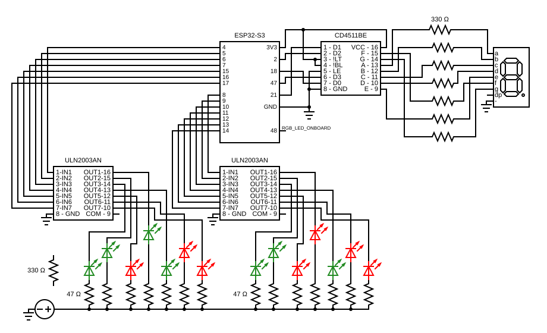

# Atividade 05b - O problema da mochila

## Função

Aplicar a lógica do Problema da Mochila sobre a árvore binária recursiva. O objetivo é explorar todas as combinações de "pegar" ou "não pegar" itens, calculando a soma dos valores e o peso total de cada caminho.

Para mostrar visualmente o que acontece na poda, se o peso acumulado do caminho ultrapassar o limite da mochila, a recursão para naquele galho e acende o LED RGB onboard de vermelho (indicando que o caminho é inválido). Se o caminho chega até o fim dentro do limite de peso, o LED RGB acende em verde (indicando um caminho válido). O valor da soma continua sendo exibido no display de 7 segmentos durante todo o processo.

## Descrição e diagrama esquemático
- **Árvore de LEDs:** 14 LEDs organizados em 3 níveis (raiz virtual sem LED, 2 no primeiro nível, 4 no segundo e 8 nas folhas). Cada LED é controlado por um pino do ESP32.

- **LEDs e ULN2003AN:** Os LEDs usados são filamentos rígidos de cerâmica de 3V e 55mA, acompanhados por resistores de 47Ω e alimentação externa de 5V. Como a corrente dos filamentos excede o limite das portas do ESP32, foram utilizados dois CIs ULN2003AN para fazer o chaveamento seguro dos LEDs.

- **Array de LEDs:** Os pinos foram organizados em um único array unidimensional de 15 posições (o índice 0 é nulo).

- **Display de 7 segmentos:** Ligado ao ESP32 através do CI CD4511 (decodificador BCD). O CI recebe 4 bits do ESP32 e acende o número correspondente. O código atualiza o valor no display em tempo real.

- **Valores:** O array `valores[]` define os itens que podem ser somados no caminho.

- **Lógica de Poda:** A função recursiva agora recebe também o `pesoTotal`. Antes de descer para o próximo nível, ela testa se o `pesoTotal` estourou o limite. Se sim, aciona o feedback vermelho e dá um return.

- **LED RGB Onboard:** Utilizado para o feedback visual de poda (vermelho) e de caminho completo (verde). Controlado pela função `rgbLedWrite`.

- **No caso de poda:** o display mostra o valor da soma do nó pai (desfazendo a soma do item que estourou o peso), mantendo o visor coerente com o último estado válido.

Nota: O resistor adicional na esquerda no diagrama esquemático (330Ω) serve como referência caso o circuito seja montado com LEDs comuns ao invés de filamentos.

## O que aprendi na atividade 05b
- **WS2812:** Para usar o LED RGB da placa, é possível utilizar funções nativas com o `neopixelWrite(pino, R, G, B)`(obsoleta), `rgbLedWrite(pino, R, G, B)` e no caso de ser um WS2812 onboard, é possível usar `RGB_BUILTIN` ao invés de indicar o pino 38 ou 48 dependendo da placa ESP32-S3.

- **Timing do WS2812:** O protocolo do LED RGB pode exigir um tempo de reset no barramento. Um delay(5) antes do comando de escrita resolveu as falhas em que o LED não acendia.

## Dificuldades
- **Feedback Visual Sincronizado:** Acertar a hora exata de mostrar o valor do pai no display durante a poda.

- **LED RGB não acendendo:** O LED RGB não acendia durante alguns ciclos e aparentemente de forma aleatória. Depois de entender timing de reset foi resolvido.